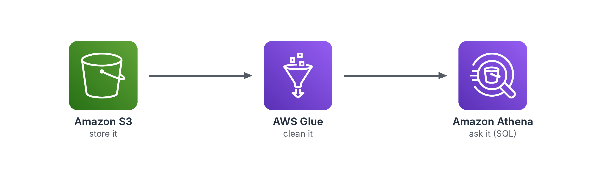
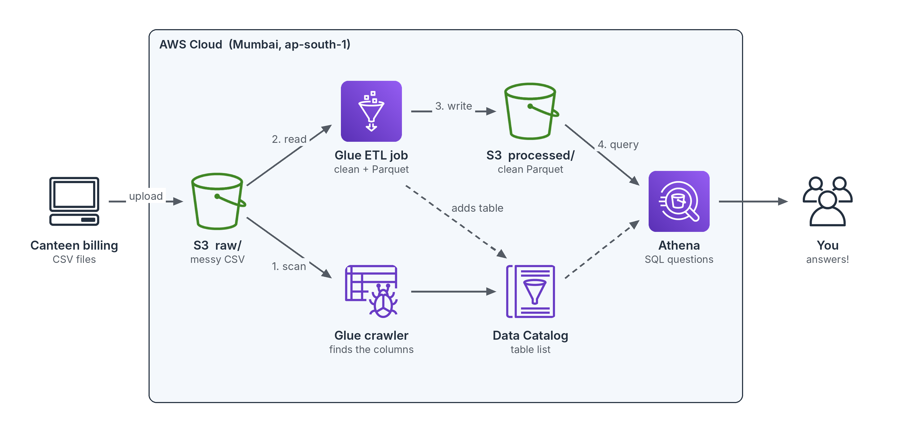

# How Data Moves on AWS

A beginner-friendly data pipeline with **Amazon S3**, **AWS Glue** and **Amazon Athena**.

Built for the talk *How Data Moves on AWS* by [Nirmal Chhodvadiya](https://www.linkedin.com/in/nirmalpatel008) at SCD, PPSU (26 Nov 2026).

Full walkthrough article: AWS Builder Center (link added after publishing).



## The story

Our campus canteen has a billing counter that saves every order as a CSV file. The owner wants answers:

- What do students order the most?
- Which item makes the most money?
- When is rush hour?
- How many people pay with UPI vs cash?

The data is messy (just like real life): `Vada Pav`, `VADA PAV` and `  vada pav ` are all the same item, some rows are duplicates, some payment modes are blank, and some orders were cancelled.

We'll store the data in S3, clean it with Glue, and ask questions with Athena. No servers to manage.



| Step | Service | What it does here |
|---|---|---|
| 1 | Amazon S3 | Stores the raw CSV files (`raw/`) and the clean Parquet files (`processed/`) |
| 2 | Glue crawler | Looks at the CSV files and figures out the columns |
| 3 | Glue Data Catalog | Keeps the list of tables, so other services know what the data looks like |
| 4 | Glue ETL job | Cleans the data and saves it as Parquet, one folder per day |
| 5 | Amazon Athena | Lets you run SQL on files in S3, and you pay per data scanned |

## What's in this repo

```
data/generate_orders.py       makes fake canteen orders (already generated for you)
data/raw/orders/*.csv         5 days of messy orders (2,950 rows)
glue/clean_orders_job.py      the Glue ETL job (PySpark)
athena/queries.sql            all the SQL we run in the demo
scripts/setup.sh              creates the bucket, IAM role and Glue database
scripts/cleanup.sh            deletes everything when you're done
images/                       architecture diagrams
```

## Before you start

- An AWS account. New accounts get Free Tier credits that easily cover this demo.
- Use the **Mumbai (ap-south-1)** region (top right of the console). Any region works, just stay in one.
- Expected cost: a few cents. The crawler is billed for at least 10 minutes per run and the Glue job for at least 1 minute, at about $0.44 per DPU-hour. Athena charges by data scanned, and our data is tiny. Run the cleanup script at the end.
- If you're on the AWS Free plan and a service says it isn't available, the console will tell you. You can switch to the Paid plan and your credits still apply.

## Step 1: Setup (2 minutes, in CloudShell)

1. In the AWS console, click the **CloudShell** icon (the `>_` at the top).
2. Run:

```bash
git clone https://github.com/nirmalpatel008/how-data-moves-on-aws.git
cd how-data-moves-on-aws
bash scripts/setup.sh
```

3. Copy the values it prints at the end. You'll need the bucket name.

> Want to make your own data instead? Run `python3 data/generate_orders.py` before `setup.sh`.

## Step 2: Look at the raw data in S3

1. Open **S3** and click your bucket `how-data-moves-<account-id>-ap-south-1`.
2. Open `raw/orders/`. You'll see 5 CSV files, one per day.
3. Click one file and choose **Open** (or **Download**). Notice the messy item names.

## Step 3: Create a Glue crawler

1. Open **AWS Glue > Data Catalog > Crawlers > Create crawler**.
2. Name: `canteen-raw-crawler`. Click **Next**.
3. **Add a data source**: S3, path `s3://<your-bucket>/raw/orders/`. Click **Next**.
4. IAM role: choose `GlueDemoRole`. Click **Next**.
5. Target database: `canteen_db`. Schedule: **On demand**. Click **Next**, then **Create crawler**.
6. Click **Run crawler**. Wait about a minute until the status is **Completed**.
7. Go to **Data Catalog > Tables**. You now have a table called `orders`. Click it and look at the columns the crawler found.

## Step 4: Peek at the mess with Athena

1. Open **Amazon Athena > Query editor**.
2. If Athena asks for a query result location, go to **Settings > Manage** and enter `s3://<your-bucket>/athena-results/`.
3. On the left, choose Database **canteen_db**.
4. Run the **PART A** queries from [`athena/queries.sql`](athena/queries.sql). Query A3 shows the same item spelled in many ways (56 spellings for 14 items).

## Step 5: Create and run the Glue ETL job

1. Open **AWS Glue > ETL jobs**, choose **Script editor**, engine **Spark**, and **Upload script**. Pick `glue/clean_orders_job.py` from this repo (download it from GitHub first if you're on your laptop). Click **Create script**.
2. Open the **Job details** tab:
   - Name: `clean-canteen-orders`
   - IAM role: `GlueDemoRole`
   - Glue version: the latest one in the list
   - Worker type: `G.1X`, Requested number of workers: `2` (smallest and cheapest)
3. Scroll to **Advanced properties > Job parameters** and add these four:

| Key | Value |
|---|---|
| `--DATABASE` | `canteen_db` |
| `--SOURCE_TABLE` | `orders` |
| `--TARGET_PATH` | `s3://<your-bucket>/processed/orders_clean/` |
| `--TARGET_TABLE` | `orders_clean` |

4. Click **Save**, then **Run**. Open the **Runs** tab. It takes about 1 to 2 minutes and should end with **Succeeded**.
5. Check S3: `processed/orders_clean/` now has folders like `order_date=2026-11-16/` with `.parquet` files inside.
6. Check the Data Catalog: there's a new table `orders_clean`. The job created it for you.

### What the job does

| Problem in raw data | Fix in the job |
|---|---|
| `VADA PAV`, `  vada pav ` | trim spaces and use Title Case: `Vada Pav` |
| Numbers stored as text | cast to int / double |
| Blank payment mode | set to `Unknown` |
| Quantity 0 (cancelled) | remove the row |
| Same order twice | remove duplicates by `order_id` |
| No total, no hour | add `total_amount`, `order_hour`, `order_date` |
| CSV is slow to query | save as Parquet, one folder per day |

## Step 6: Get answers with Athena

Run the **PART B** queries from [`athena/queries.sql`](athena/queries.sql). With the data in this repo you should see:

- Most ordered: **Cutting Chai** (649 cups), then Vada Pav (592)
- Most money: **Cold Coffee** (Rs 17,200)
- Payments: **UPI 73.5%**, Cash 18.5%, Card 5.1%, Unknown 2.8%
- Rush hour: **1 PM**, then 11 AM and 4 PM
- 2,837 clean orders and Rs 1,25,405 in total over 5 days

Then run **PART C** and compare the **Data scanned** number for CSV vs Parquet.

## Step 7: Clean up (do not skip)

In CloudShell:

```bash
bash scripts/cleanup.sh
```

This deletes the Glue job, crawler, database, IAM role and the S3 bucket.

## Try this next

- Add a 6th day of data, upload it to `raw/orders/`, run the job again, and re-run the queries.
- Schedule the crawler and job with a **Glue workflow** or **Glue trigger**.
- Build a chart from your Athena results in **Amazon QuickSight**.
- Ask Athena a new question: which counter sells the most Cold Coffee after 4 PM?

## Learn more

- [Amazon S3 user guide](https://docs.aws.amazon.com/AmazonS3/latest/userguide/Welcome.html)
- [AWS Glue developer guide](https://docs.aws.amazon.com/glue/latest/dg/what-is-glue.html)
- [Amazon Athena user guide](https://docs.aws.amazon.com/athena/latest/ug/what-is.html)
- [AWS Glue pricing](https://aws.amazon.com/glue/pricing/) and [Athena pricing](https://aws.amazon.com/athena/pricing/)

## License

MIT. Use it, fork it, teach with it.
